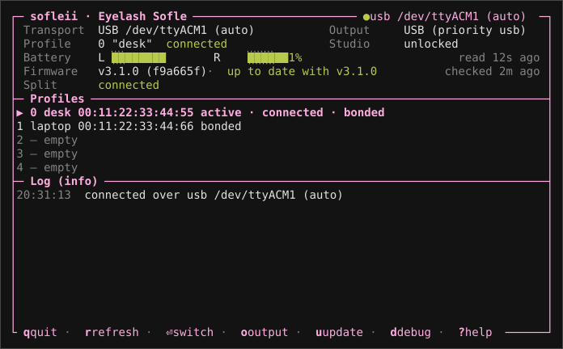

# sofleii

ZMK firmware for the **Eyelash Sofle** split keyboard, plus **sofleii**, a Rust CLI/TUI to manage it.

**[Docs](https://sofleii.dlu.one)** · **[Keymap](https://sofleii.dlu.one/keymap/)** ([PDF](https://sofleii.dlu.one/sofleii-keymap.pdf)) · [Releases](https://github.com/rdlu/sofleii/releases) · [Roadmap (#44)](https://github.com/rdlu/sofleii/issues/44)

> [!WARNING]
> **Personal configuration — use at your own risk.**
> Releases are experimental and built for one specific keyboard. Key layout, timing, and layer assignments are tuned to personal preference and may change without notice. If you have the same hardware, feel free to use this as a starting point, but do not expect a stable or general-purpose firmware.

> Original hardware by [380465425@qq.com](mailto:380465425@qq.com) · vendor repo [a741725193/zmk-sofle](https://github.com/a741725193/zmk-sofle) (original README, 3D case model); see [Hardware](https://sofleii.dlu.one/docs/hardware/).

[](https://sofleii.dlu.one/keymap/)

Every layer, with its own page and key grid: **[sofleii.dlu.one/keymap](https://sofleii.dlu.one/keymap/)**.

## Highlights

- **v3.0.0** on ZMK `main` / Zephyr 4.1 (cormoran's `main+dya` fork), nice!nano v2 + nice!view on both halves.
- **10 layers:** BASE, NAV, CODE, MEDIA, SYS|NUM, the GAME? picker, three game layers (MINECRFT, GAME, NOMANSKY) and the MYGAME custom slot.
- **Home-row mods** with an opposite-hand rule and a faster index-finger Shift; AltGr on a right-thumb mod-tap.
- **Gaming layers** with no hold-taps at all: pick one from SYS|NUM, leave with the two top corners.
- **Per-layer underglow** from the in-repo `zmk-rgb-layer` module: BASE moods, master brightness, remembered across reboots.
- **Studio** live keymap editing on the left half, over USB and Bluetooth.
- **Soft off:** hold Q+S+Z for 2 seconds.

## Quick start

**Flash a release** (needs `mise` and an authenticated `gh`; double-tap reset on each half when asked):

```bash
mise run flash-release
```

On a major upgrade, flash the settings reset first (`mise run flash-release-reset`), see [Upgrading to v3](https://sofleii.dlu.one/docs/upgrading-to-v3/). Flashing without `mise`: [Flashing](https://sofleii.dlu.one/docs/flashing/).

**Build locally** (Arch Linux; full guide in [Building](https://sofleii.dlu.one/docs/building/)):

```bash
mise run setup                              # once: west workspace + Python deps
mise run doctor                             # workspace matches config/west.yml?
mise run build-left && mise run build-right
```

**Docs site** (Hugo, from `site/`):

```bash
mise run docs                               # http://127.0.0.1:1313/
```

## sofleii CLI/TUI

A Rust CLI and ratatui TUI for the keyboard, over the same Studio RPC the web app uses: a live dashboard, the split link, both batteries, BLE profiles, the output priority and firmware update checks. Every reading is also a subcommand with `--json`, stable exit codes and a waybar module.



```bash
mise run sofleii                              # the TUI (built from the repo)
mise run sofleii -- status                    # one-shot summary
mise run sofleii -- battery --format waybar   # for a waybar module
mise run sofleii -- update check || notify-send "Sofle firmware update"
```

Not released yet: build it from the repo (or `cargo install --path sofleii --locked`); prebuilt binaries come with v0.1.0 ([#83](https://github.com/rdlu/sofleii/issues/83)). Docs: **[sofleii.dlu.one/docs/sofleii](https://sofleii.dlu.one/docs/sofleii/)** · roadmap [#44](https://github.com/rdlu/sofleii/issues/44).

## More

- Memory budget per half: [Firmware reference](https://sofleii.dlu.one/docs/reference/firmware/#memory-budget).
- Window-manager keybinds (niri, GNOME, COSMIC) for the NAV layer: [WM_KEYBINDS.md](WM_KEYBINDS.md).

## License

MIT, see [LICENSE](LICENSE). Third-party parts keep their own licenses: the vendored Hextra theme, FlexSearch and fonts under `site/`, files with their own SPDX headers, the ZMK-derived physical layout (MIT), and `keymap_drawer.config.yaml`; [LICENSE](LICENSE) lists them all.
